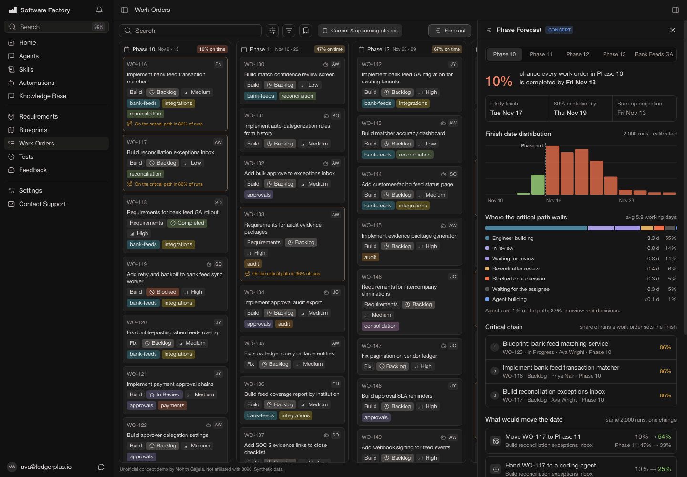

# Phase Forecast for 8090 Software Factory (concept)

**Live demo:** https://mohith26.github.io/8090-phase-forecast/

An unofficial concept feature for the Work Orders module of [8090 Software Factory](https://www.8090.ai/software-factory): a calibrated forecast of whether each phase will close on time, which work orders set the date, where the critical path is actually waiting, and which single change would move the date the most.

*Unofficial concept demo by Mohith Gajjela. Not affiliated with 8090. All data is synthetic.*



## Why

Software Factory already turns requirements and blueprints into phased work orders that coding agents pick up over MCP. Once agents write code in minutes, a phase's finish date is set by the human parts of the system: review capacity, decisions that block work from starting, rework when an agent's PR bounces, and dependency chains through blueprint and requirements work. A burn-up projection (remaining items ÷ recent throughput) hides all of that. In this demo's project it says Phase 10 lands Fri Nov 13; the calibrated forecast gives that a 10% chance and points at the three-item chain that decides it.

## What it shows

On the Work Orders board (current and upcoming phases), each phase header gets an on-time probability, and cards that sit on the critical path in at least 30% of runs say so. The Forecast panel adds:

- **On-time probability and finish dates** (likely, 80% confident) next to the burn-up projection.
- **Finish-date distribution** from 2,000 simulated runs, calibrated.
- **Where the critical path waits:** time on the chain that sets the finish, split into agent building, engineer building, waiting for the assignee, waiting for review, in review, rework, and blocked on a decision.
- **Critical chain:** the share of runs in which each work order is on the path that sets the phase's finish.
- **What would move the date:** add a reviewer, same-day decisions, hand a critical work order to a coding agent, or move the tail to the next phase, each evaluated on the same 2,000 runs (common random numbers), with the knock-on effect on the next phase.
- **Backtest on this project** and **what the model learned** (all estimated from the activity history).
- A mission view (parent work order "Mission - Bank Feeds GA") with the same forecast over its children.

## How it works

All numbers on the page are computed in the browser from `data/project.json` (the activity log of every work order: status changes plus linked-PR review events) by the code in `core/`.

1. **Learn the process from history** (`core/fit.mjs`). For each stage, durations are estimated with **Kaplan-Meier survival curves**, treating work still open at the snapshot as **right-censored** instead of dropping it (dropping it biases durations short). Build time is stratified by executor (agent vs engineer) and work-order type, falling back to the executor's pooled curve when a stratum has fewer than 12 completed spells. Review service time, rework time and decision waits get their own curves. Bounce-in-review rates (first round vs later rounds) and decision-gate rates by type are Beta posteriors with partial pooling. **Review capacity** is learned only on days when PRs were queuing (on those days, reviews in service = capacity). Unplanned mid-phase fixes are a Gamma-Poisson rate with a negative-binomial term when phases vary more than Poisson allows. A **latent difficulty factor** (Gaussian copula) couples a work order's build time, review time and bounce probability, with the correlation estimated from normal scores of within-stratum ranks.
2. **Simulate** (`core/engine.mjs`). A discrete-event simulator plays the plan forward: work orders wait for their phase and their blockers, may first wait on a decision, then compete for each engineer's coding slot, a pool of concurrent agent sessions (the org setting), and the review pool, bouncing back for rework with the learned probabilities. In-flight work is resumed from its current state, drawing the remaining time from the survival curve conditioned on the time already spent. Each run also resamples the history (bootstrap) and the Beta posteriors so parameter uncertainty is in the spread.
3. **Attribute.** In each run the phase's last-finishing work order is traced back through the constraint that bound each start (a blocker finishing, the phase starting) to build the critical chain and the time breakdown.
4. **Counterfactuals.** Interventions rerun the same seeds with one change; per-work-order random streams keep everything else identical, so differences are due to the change, not noise.
5. **Calibrate.** A rolling-origin **backtest** replays forecasts from Tuesdays and Thursdays of past phases using only the history available then. The simulated distribution is then rescaled around its median by **split-conformal** scale *s*: the ⌈0.8(n+1)⌉-th smallest normalized miss over those past forecasts.

## Does it work?

On the demo project's own history (21 past forecasts, phases 3-9): Brier score 0.09 vs 0.29 for the burn-up projection, median-date error 1.2 vs 1.7 working days, and the 80% ranges contained the actual finish 95% of the time before calibration.

On **16 independently generated projects**, forecasting phases 10-13 from the same Tuesday snapshot and scoring against each project's realized future (`node scripts/calibration.mjs 16 600`, 64 forecasts):

| | Brier (on-time) | 80% range hit rate | Median-date error |
|---|---|---|---|
| Burn-up projection | 0.359 | n/a (point estimate) | 3.1 working days |
| Simulation, raw | 0.156 | 70% | 2.0 |
| Simulation + conformal scale | 0.155 | 86% | 2.0 |

The raw simulation is overconfident (70% hit rate for an 80% range); the conformal step brings it to 86%, slightly conservative. Forecasts are biased about 0.8 working days early; an oracle that knows the true generating parameters shows a similar bias, so part of it is noise at this sample size.

## Data

`scripts/synth.mjs` (seed 8090) generates "Ledger Plus", a fintech team on weekly phases (Sep 7 to Dec 13, 2026), with six engineers and their coding agents. The ground truth uses a hidden process the forecaster never sees: lognormal stage times scaled by a per-work-order complexity factor, agent PRs that bounce more often, two reviewers with one out on about 30% of days, decision waits, unplanned fixes, and an agent share that rises from 22% to over 60% of build work. `data/project.json` contains only events before the snapshot (Tue Nov 10, 9:00); `data/truth.json` (the realized future) is used only by tests and the calibration script.

## Run it

```bash
node scripts/generate.mjs              # regenerate data/
node --test test/                      # 13 tests
node scripts/calibration.mjs 16 600    # multi-project calibration table
python3 -m http.server                 # then open http://localhost:8000
```

No build step and no dependencies; the page loads Lucide icons from a CDN.

## Tests

`test/forecast.test.mjs` covers Kaplan-Meier with and without censoring, conditional draws given elapsed time, state derivation from the activity log, simulator invariants (every work order finishes, blockers and phase starts respected, review and agent capacity never exceeded), recovery of the hidden process from history, the difficulty-correlation estimator, internal consistency of the forecast, common-random-number reproducibility, the conformal scale, backtest leakage, and the multi-project calibration check.

## Limitations (honest)

- Synthetic data. The generator and forecaster share the same simulator skeleton (queues, phases, dependencies), so the calibration numbers show the estimators work, not that real teams behave like this. Real projects need their own backtest, which is why the calibration step uses the project's own history.
- Review is modeled as one shared pool; real teams route reviews to specific people. Reassignments, holidays (Thanksgiving falls in Phase 12), and scope added to future phases after the snapshot are not modeled beyond the unplanned-fix rate.
- Phase completion means every work order in the phase is Completed; parent work orders (missions) are tracked through their children.
- The fonts fall back to Helvetica Neue; the production app uses Söhne. Icons are Lucide, as in the app.

## Novelty note

I checked the Software Factory changelog (v0.23 to v0.59, Nov 2 2026), the public roadmap, and the Work Orders docs: phases, roadmap view, saved views, PR status and dependency fields are there, but no completion forecast, on-time probability, critical-path analysis or what-if planning. Monte Carlo delivery forecasting does exist in third-party tools for Jira and Azure Boards (LinearB Project Forecast, ActionableAgile, Empirical Forecasting), and Linear shows a velocity-based projected date with a ±40% band. What this demo adds on top of those is modeling the agent era explicitly: agent vs engineer executors, a learned review-capacity queue, decision gates, rework loops, censoring-aware duration curves, critical-chain attribution, counterfactual interventions on common random numbers, and a conformal calibration step checked against the project's own past forecasts.
